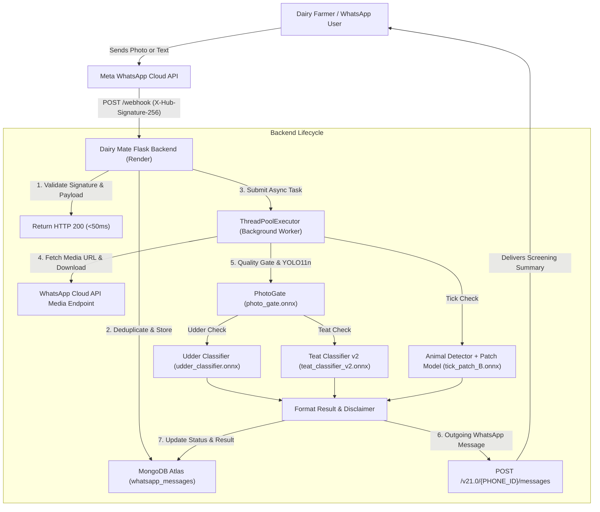

# Dairy Mate AI WhatsApp Integration Architecture & Operations Guide

Production backend integrating WhatsApp Cloud API, Meta Webhooks, MongoDB Atlas, and three computer-vision screening pipelines (Udder, Teat, and Tick).

---

## 1. System Architecture



---

## 2. API Endpoints

| Endpoint | Method | Description |
|---|---|---|
| `/` | `GET` | Service health status for Render uptime checks |
| `/models/health` | `GET` | Model inference availability health check |
| `/system/status` | `GET` | Diagnostic check reporting MongoDB, credential flags, and model readiness |
| `/models/predict` | `POST` | Direct multipart form (`image` + `model`) or binary prediction endpoint for testing |
| `/webhook` | `GET` | Meta Webhook subscription handshake (`hub.challenge`) |
| `/webhook` | `POST` | Meta WhatsApp event receiver with signature verification and async queue dispatch |

---

## 3. Configuration & Environment Variables

Never commit `.env` or hardcode credentials into the repository. Configure the following environment variables in your Render Dashboard or local environment:

| Variable Name | Required | Default | Description |
|---|---|---|---|
| `MONGODB_URI` | Yes | — | MongoDB Atlas connection string (`mongodb+srv://...`) |
| `MONGODB_DB_NAME` | No | `dairy_mate` | Target MongoDB database name |
| `META_VERIFY_TOKEN` | Yes | — | Shared verification token configured in Meta App Webhook settings |
| `META_APP_SECRET` | Recommended | — | App Secret from Meta App Dashboard (used for `X-Hub-Signature-256` HMAC validation) |
| `WHATSAPP_ACCESS_TOKEN` | Yes | — | WhatsApp Cloud API System User Token (or temporary 24h developer token) |
| `WHATSAPP_PHONE_NUMBER_ID` | Yes | — | Registered Phone Number ID from WhatsApp Cloud API Setup |
| `WHATSAPP_GRAPH_API_VERSION` | No | `v21.0` | Meta Graph API version (`v21.0`, `v20.0`, etc.) |
| `PORT` | No | `5000` | Port for Flask web server |
| `DM_ORT_THREADS` | No | `1` | ONNX runtime intra-op threads (optimized for memory constrained instances) |

---

## 4. Root Cause Analysis & Diagnostic Findings

### Why Did WhatsApp Images Not Receive a Response?

1. **Expired Temporary Access Token (`code: 190`)**:
   - The token in `.env` was a temporary 24-hour developer token that expired.
   - When Meta delivered an image event, `download_whatsapp_media` called `https://graph.facebook.com/{version}/{media_id}` with the expired token, throwing HTTP 401 Unauthorized (`OAuthException: code 190`).
   - The error handler attempted to send an error message via `send_text`, which also failed with HTTP 401 Unauthorized, resulting in complete silence to the WhatsApp user.
2. **Synchronous Webhook Execution & Meta Webhook Timeout**:
   - The original code ran image download, ONNX model loading, gate routing, and classification synchronously inside `receive_webhook`.
   - On free-tier Render instances with cold starts or limited CPU, processing exceeded 5–10 seconds. Meta's webhook delivery timed out, resulting in dropped or retried events.
   - **Resolution**: Implemented non-blocking architecture using `ThreadPoolExecutor`. The webhook returns HTTP 200 within 50ms, while background workers handle the inference and reply pipeline.
3. **Missing MongoDB Lifecycle Tracking**:
   - The previous implementation only recorded `status: "received"` and never updated documents with predictions, processing stages, or failure details.
   - **Resolution**: Fully instrumented MongoDB pipeline tracking message receipt, processing state, model used, probability, confidence, output message, and structured error logs.
4. **Strict Image Caption Requirement**:
   - Previously, if a user uploaded an image without typing `udder`, `teat`, or `tick`, the message was rejected.
   - **Resolution**: Added session-based context memory in MongoDB (`user_sessions`). If an image is sent without a caption, Dairy Mate AI prompts the user:
     *"📸 Photo received! Which screening would you like to run? Reply with: udder, teat, or tick."*
     When the user replies with their choice, the system automatically retrieves the pending photo and completes the screening.

---

## 5. Local Setup & Testing

### Prerequisites
- Python 3.11 or 3.12
- Active MongoDB Atlas cluster or local MongoDB instance

### Installation
```bash
# Clone the repository
git clone https://github.com/Satwik265/dairy-mate-whatsapp.git
cd dairy-mate-whatsapp

# Create virtual environment
python -m venv .venv

# Activate virtual environment
# Windows:
.venv\Scripts\activate
# Linux/macOS:
source .venv/bin/activate

# Install dependencies
pip install -r requirements.txt
```

### Running Test Suite
```bash
python -m unittest discover -s tests
```

### Running the Server
```bash
gunicorn --bind 0.0.0.0:5000 --workers 1 --threads 4 app:app
```

---

## 6. Meta Developer Portal Configuration Guide

### A. Webhook Callback URL & Verification
1. Log in to [Meta for Developers](https://developers.facebook.com/).
2. Select your app: **Dairy Mate AI**.
3. Under **WhatsApp** > **Configuration**, locate the **Webhooks** section.
4. Click **Edit**:
   - **Callback URL**: `https://dairy-mate-whatsapp-11.onrender.com/webhook`
   - **Verify Token**: Must match `META_VERIFY_TOKEN` in your environment.
5. Click **Verify and Save**.
6. Under Webhook Fields, ensure **`messages`** is subscribed.

### B. Test Phone Number Rules (Development Mode)
- In Development Mode, Meta restricts test numbers.
- You **must** add any tester phone numbers under **WhatsApp** > **API Setup** > **To** recipient dropdown > **Manage phone number list**.
- An OTP is sent to the recipient's WhatsApp to verify their device. Once verified, that phone can send and receive WhatsApp messages with the test number.

### C. Transition to Production Permanent Token (System User)
To prevent the 24-hour token expiration issue in production:
1. Go to **Meta Business Suite** > **Settings** > **Users** > **System Users**.
2. Click **Add** to create a System User (Role: Admin or Employee).
3. Click **Add Assets** and assign your WhatsApp Business Account.
4. Click **Generate New Token**:
   - Select your app: **Dairy Mate AI**.
   - Token expiration: **Never** (or 60 days).
   - Select permissions:
     - `whatsapp_business_messaging`
     - `whatsapp_business_management`
5. Copy the generated permanent token and configure it as `WHATSAPP_ACCESS_TOKEN` in Render Environment Settings.
